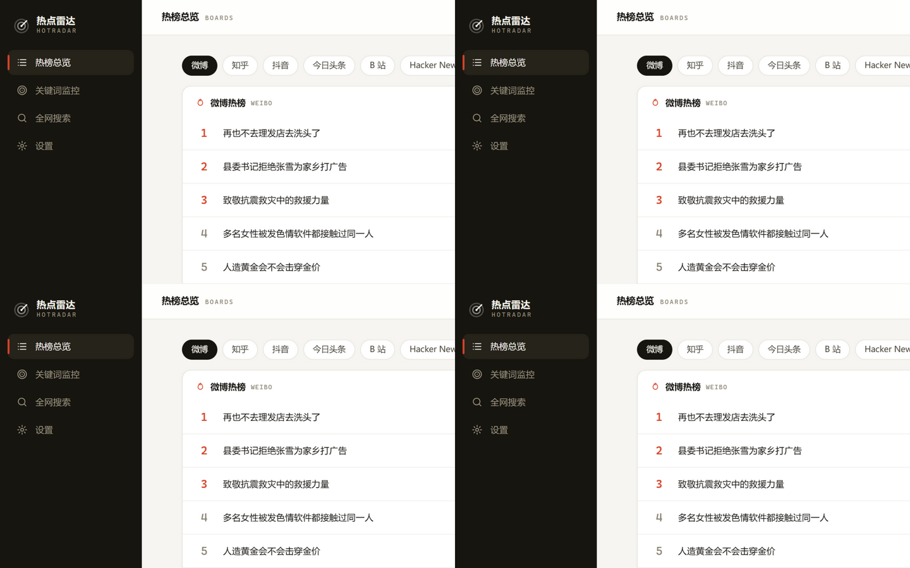
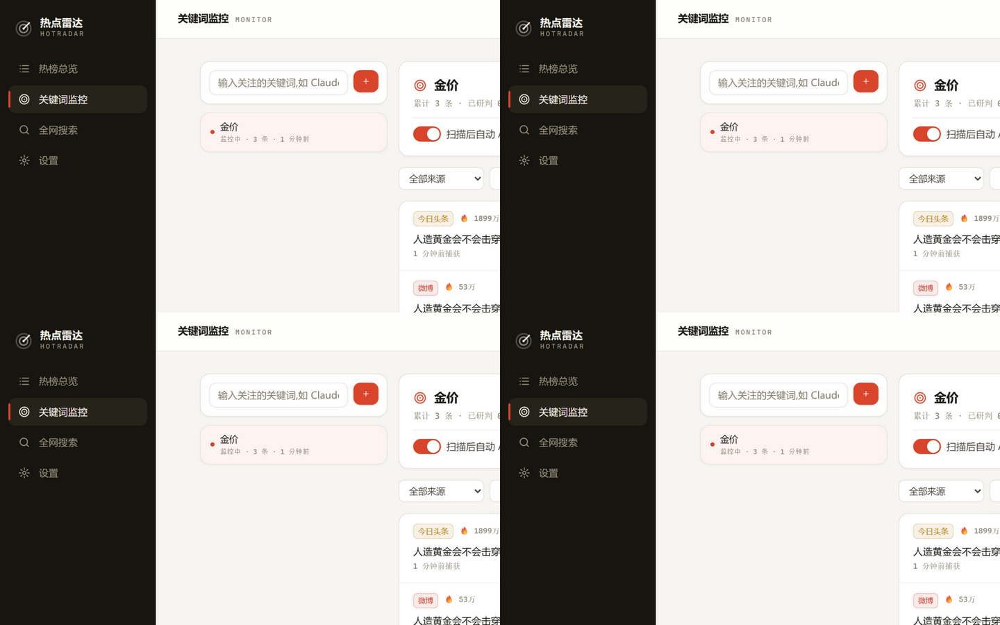

<div align="center">


# 热点雷达 HotRadar

**纯前端的多平台热榜聚合 + AI 关键词监控面板**

零后端 · 零数据库 · 数据存于浏览器本地 · 可部署到任意静态托管

[](https://react.dev)
[](https://vite.dev)
[](https://tailwindcss.com)
[](https://www.typescriptlang.org)
[](LICENSE)

</div>

## 这是什么?

一个跑在浏览器里的热点监控台:

- **热榜总览** —— 微博 / 知乎 / 抖音 / 今日头条 / B 站 / Hacker News 六个榜单一站式查看,按相对热度可视化;
- **关键词监控** —— 添加你关心的关键词,一键从全部热榜 + HackerNews 聚合扫描,命中内容入库留存、去重合并,新内容即时通知;
- **AI 研判** —— 接入 OpenRouter 任意模型,对每条命中内容做相关度评分、真实性判断、重要度分级与一句话摘要;
- **全网搜索** —— 不入库的即时聚合检索,支持按平台筛选与批量 AI 研判;
- **零后端** —— 没有服务器、没有数据库。关键词、监控历史、通知、设置全部存在浏览器 localStorage,构建产物是一堆静态文件,扔到任何静态托管就能跑。

## 界面

| 热榜总览 | 关键词监控 |
| --- | --- |
|  |  |

## 快速开始

```bash
git clone https://github.com/rwzdk/hot-radar.git
cd hot-radar
npm install
npm run dev        # http://localhost:5173
```

构建生产包:

```bash
npm run build      # 产物在 dist/
npm run preview    # 本地预览构建产物
```

## 启用 AI 研判(可选)

AI 能力通过 [OpenRouter](https://openrouter.ai) 提供,浏览器直连、无需服务器:

1. 到 [openrouter.ai/keys](https://openrouter.ai/settings/keys) 创建一个 API Key(建议设置消费上限);
2. 打开本站「设置」页,填入 Key,点「测试」验证;
3. 回到「监控」页,对扫描结果单条「研判」或批量「AI 研判」。

> 密钥只保存在你自己浏览器的 localStorage,请求由浏览器直发 OpenRouter,本项目没有任何后端中转。默认模型 `deepseek/deepseek-v3.2`,可在设置页更换为 OpenRouter 上的任意对话模型。

## 部署

`npm run build` 产出的 `dist/` 是完全自包含的静态站点:

- **Qoder Sites** —— 直接发布 `dist/` 目录(免费版仅支持静态部署,本项目正是为此设计);
- **Vercel / Netlify / Cloudflare Pages** —— 按框架预设 Vite 自动识别,零配置;
- **GitHub Pages** —— `vite build` 后将 `dist/` 推到 `gh-pages` 分支即可。

项目使用 hash 路由(`#/monitor`),不需要服务端 SPA 回退规则,静态文件服务器直接可用。

## 数据从哪来?

| 数据源 | 用途 | 说明 |
| --- | --- | --- |
| [60s API](https://github.com/vikiboss/60s) | 微博/知乎/抖音/头条/B站热榜 | 公开聚合接口,允许浏览器跨域 |
| [HN Search API (Algolia)](https://hn.algolia.com/api) | HackerNews 榜单与全文搜索 | 官方免费接口,允许跨域 |
| OpenRouter | AI 研判 | 用户自带 Key,浏览器直连 |

**快照兜底机制**:仓库内置 GitHub Actions(见 [`.github/workflows/snapshot.yml`](.github/workflows/snapshot.yml)),每天定时抓取各榜单生成 `public/data/snapshot.json` 并提交回仓库。运行时实时接口拉取失败(接口变更、限流、断网)会自动回退到这份快照,保证榜单页始终有数据可看。也可以手动触发:`npm run snapshot`。

## 技术栈与结构

```
React 19 + TypeScript + Vite 7 + Tailwind CSS v4
运行时依赖只有 react / react-dom,路由、图标、存储、通知全部手写

src/
├─ app.tsx               # 路由入口(hash 路由,四页切换)
├─ styles.css            # 设计令牌(@theme)+ 动画
├─ components/
│  ├─ shell.tsx          # 墨色侧栏 + 顶栏 + 通知中心
│  ├─ ui.tsx             # Button/Card/Badge/热力条/相关度仪表…
│  ├─ icons.tsx          # 手写 SVG 图标集
│  └─ result-card.tsx    # 监控/搜索结果卡片(含 AI 结论区)
├─ pages/
│  ├─ boards.tsx         # 热榜总览
│  ├─ monitor.tsx        # 关键词监控(扫描/历史/过滤/研判)
│  ├─ search.tsx         # 全网搜索
│  └─ settings.tsx       # 密钥/通知/备份/数据源体检
└─ lib/
   ├─ boards.ts          # 多源热榜适配 + 快照兜底
   ├─ hackernews.ts      # HN Algolia 客户端
   ├─ aggregate.ts       # 关键词聚合扫描 + 历史合并去重
   ├─ ai.ts              # OpenRouter 直连与批量研判
   ├─ storage.ts         # localStorage 持久化 + 备份导入导出
   ├─ notices.tsx        # 应用内通知中心 + 浏览器通知
   ├─ router.ts          # hash 路由
   └─ format.ts          # 时间/数值格式化
```

## 已知边界

- 微博/B站等平台官方接口不允许浏览器跨域,本项目通过开源聚合接口间接获取,单条源失效不影响其他源(自动降级 + 快照兜底);
- 监控是"打开页面时"的拉取式扫描,不是 7×24 后台爬虫 —— 需要无人值守监控的话可参考快照工作流自行扩展定时任务;
- 第三方免费接口存在限流或停服的可能,「设置 → 数据源体检」可随时检查各源健康状态。

## License

[MIT](LICENSE) © rwzdk
