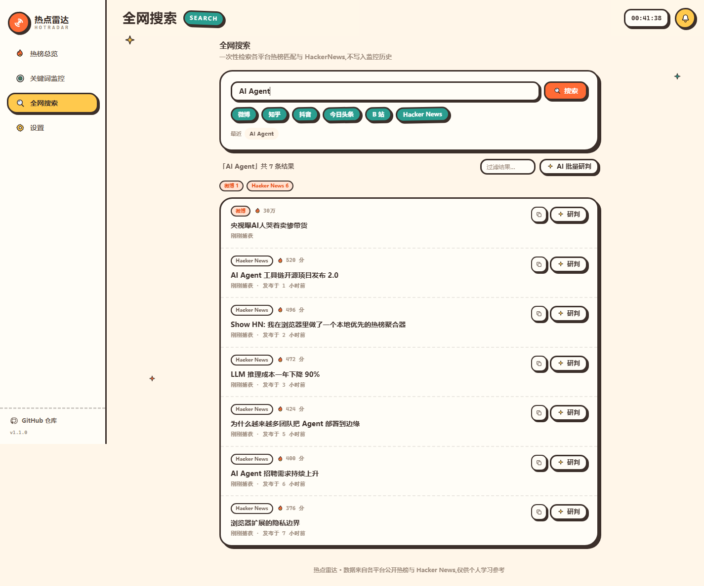
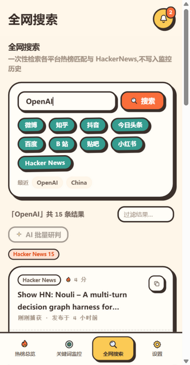

<div align="center">


# 热点雷达 HotRadar

**多平台热榜聚合 + 关键词监控 + AI 简报**

零后端 · 零数据库 · 打开即用 · 可部署到任意静态托管

[](https://react.dev)
[](https://vite.dev)
[](https://tailwindcss.com)
[](https://www.typescriptlang.org)
[](LICENSE)
[](https://github.com/rwzdk/hot-radar/actions/workflows/ci.yml)
[](https://hot-radar-j8vzdjdlheu.qoder.website)

**在线体验:https://hot-radar-j8vzdjdlheu.qoder.website**

</div>

## 这是什么?

一个跑在浏览器里的热点监控台:

- **热榜总览** —— 「聚合」一屏看九大平台(微博 / 知乎 / 抖音 / 头条 / 百度 / B站 / 贴吧 / 小红书 / Hacker News)各前 10 条,也可单榜细看,按榜内相对热度可视化;对比每日快照标出「新上榜」和排名升降;先展示最近快照再后台刷新,实时接口限流/失败也不会出现空白榜单;
- **关键词监控** —— 添加关注词,一键从全部热榜 + HackerNews 聚合扫描;支持关键词排除词、全局排除词、页面打开期间的定时自动扫描(多关键词共享一次热榜拉取),命中内容去重留存并通知;
- **关注点推送** —— 监控页切到「关注点」,用一句自然语言描述兴趣;AI 提取标签做本地粗筛,只对新增候选批量精排,达到最低相关度才入库并通知;支持排除词、来源范围、自动扫描和 AI 简报;
- **AI 研判** —— 接入 OpenRouter 任意模型,对单条内容做相关度评分、真实性判断、重要度分级与一句话摘要;
- **AI 简报** —— 把一次扫描的关键进展压缩成一份结构化简报:一句话结论、整体脉络、关键进展和接下来值得关注的信号;
- **全网搜索** —— 不入库的即时聚合检索,支持平台多选、最近搜索、结果过滤与批量 AI 研判;
- **PWA** —— 可安装到桌面/主屏,含 192/512/maskable PNG 图标与 iOS apple-touch-icon,弱网环境可打开应用壳并查看已缓存的榜单;
- **移动端可用** —— 桌面侧栏 + 手机底部导航,四页在 375px 宽度下完整可用;
- **零后端** —— 没有服务器、没有数据库。监控记录跟着浏览器走,换设备时用备份导入导出即可。

## 界面

| 热榜总览 | 关键词监控 |
| --- | --- |
|  |  |

| 全网搜索 | 移动端 |
| --- | --- |
|  |  |

<sub>界面截图使用演示数据。</sub>

## 快速开始

需要 **Node.js 22.12+**（仓库带 `.nvmrc`，CI 使用 Node 22）。

```bash
git clone https://github.com/rwzdk/hot-radar.git
cd hot-radar
npm ci
npm run dev        # http://localhost:5174
```

构建生产包:

```bash
npm run build      # 产物在 dist/
npm run preview    # http://localhost:4173 预览构建产物
```

本地检查:

```bash
npm run typecheck  # TypeScript 类型检查
npm run snapshot:check
npm run check      # typecheck + 快照完整性 + 生产构建
```

`dev` 固定 `127.0.0.1:5174` 且 `strictPort`，端口被占用时会直接报错，不会静默换端口。

## 启用 AI 研判(可选)

AI 能力通过 [OpenRouter](https://openrouter.ai) 提供:

1. 到 [openrouter.ai/keys](https://openrouter.ai/settings/keys) 创建一个 API Key(建议设置消费上限);
2. 打开本站「设置」页,填入 Key,点「测试」验证;
3. 回到「监控」页,对单条结果「研判」、批量「AI 研判」,或点「AI 简报」生成汇总。

默认模型 `deepseek/deepseek-v3.2`,可在设置页更换为 OpenRouter 上的任意对话模型。简报是单次调用、限 15 条输入,失败不会影响已有的单条研判。

## 部署

`npm run build` 产出的 `dist/` 是完全自包含的静态站点,本项目自己的线上站点就跑在 Qoder Sites 上:[hot-radar-j8vzdjdlheu.qoder.website](https://hot-radar-j8vzdjdlheu.qoder.website)。

- **Qoder Sites** —— 直接发布 `dist/` 目录;
- **Vercel / Netlify / Cloudflare Pages** —— 按框架预设 Vite 自动识别,零配置;
- **GitHub Pages** —— `vite build` 后将 `dist/` 推到 `gh-pages` 分支即可。

项目使用 hash 路由(`#/monitor`),不需要服务端 SPA 回退规则,静态文件服务器直接可用。

## 数据从哪来?

| 数据源 | 用途 | 说明 |
| --- | --- | --- |
| [60s API](https://github.com/vikiboss/60s) | 运行时九榜实时接口 | 公开聚合接口,受网络环境/限流影响时会回退快照 |
| 各平台公开接口 | 快照生成(知乎/B站/百度/贴吧/抖音/头条) | 仅 Node 侧抓取,浏览器受 CORS 限制不直连 |
| [HN Search API (Algolia)](https://hn.algolia.com/api) | HackerNews 榜单与全文搜索 | 官方免费接口,允许跨域 |
| OpenRouter | AI 研判 / 简报 | 用户自带 Key,浏览器直连 |

### 快照、趋势与限流

仓库内置 GitHub Actions(见 [`.github/workflows/snapshot.yml`](.github/workflows/snapshot.yml)),每天定时抓取各榜单生成 `public/data/snapshot.json`;推送到 `main` 时也会刷新一次。快照生成器优先直连知乎/B站/百度/贴吧/抖音/头条,失败再回退 60s;微博/小红书走 60s。运行时实时接口拉取失败(接口变更、限流、断网)会自动回退到这份快照。

- **快照优先**:聚合页与单榜先用最近快照立即渲染,再后台刷新实时数据;60s 限流或慢响应时,用户看到的是完整快照而不是「拉取失败」;
- **趋势对比**:榜单页把实时榜单与最近一次单榜快照对比,标出「新上榜」与 `↑/↓` 排名变化;快照超过 7 天时自动隐藏趋势,避免误导;
- **单源保留与完整性校验**:某一路源抓取失败时,快照会保留该源上一次成功的数据;工作流提交前运行 `npm run snapshot:check`,缺任一榜直接失败,不再静默部署缺榜数据;
- **限流保护**:多榜请求默认单并发并留出间隔,榜单请求超时 20s;网络错误/5xx 重试一次,429 直接交给快照兜底;
- **手动刷新**:`npm run snapshot` 生成快照,`npm run snapshot:check` 校验九榜完整性。

## 关注点推送

「关键词监控」是精确包含匹配；「关注点」则是给一句自然语言描述，例如“关注 AI 芯片供应链和国产 GPU 的进展”。

1. 保存关注点时，AI 从描述提取 3-10 个标签；留空标签且未配置 AI 时回退本地分词。
2. 扫描先用标签在热榜标题里做本地粗筛，只把新增候选批量交给 AI 精排（每个关注点每轮最多 20 条）。
3. 达到最低相关度才入库并通知；同一 URL 的评分会缓存，重复扫描不会重复扣费。
4. 自动扫描复用设置页的 5/10/30 分钟间隔，页面打开时生效；通知可点击跳回对应关注点。

没有 AI Key 或 AI 失败时，关注点会退化为标签匹配，不会中断；页面关闭后不推送，需要 7×24 推送必须另接 Web Push 后端或外部 webhook。

## 技术栈与结构

```
React 19 + TypeScript + Vite 7 + Tailwind CSS v4
运行时依赖只有 react / react-dom,路由、图标、存储、通知全部手写

src/
├─ app.tsx               # 路由入口(hash 路由,四页切换,页面级 ErrorBoundary)
├─ styles.css            # 设计令牌(@theme)+ 贴纸风描边/硬投影 + 动画
├─ components/
│  ├─ shell.tsx          # 侧栏 + 顶栏 + 通知中心 + 移动端底部导航
│  ├─ ui.tsx             # Button/Card/Badge/热力条/相关度仪表…
│  ├─ icons.tsx          # 手绘多彩 SVG 图标集
│  ├─ error-boundary.tsx # 单页渲染异常兜底
│  ├─ digest-card.tsx    # 关键词/关注点共用 AI 简报卡
│  ├─ focus-editor.tsx   # 关注点创建/编辑(自然语言 + 标签 + 来源/阈值)
│  ├─ focus-panel.tsx    # 关注点扫描、精排结果、过滤与简报
│  └─ result-card.tsx    # 监控/搜索结果卡片(含 AI 结论与复制链接)
├─ pages/
│  ├─ boards.tsx         # 聚合总览 + 单榜细看(快照趋势/新上榜/本地缓存秒开)
│  ├─ monitor.tsx        # 关键词监控 / 关注点推送(扫描/自动扫描/过滤/研判/简报/导出)
│  ├─ search.tsx         # 全网搜索(最近搜索/结果过滤/批量研判)
│  └─ settings.tsx       # 密钥/扫描偏好/通知/备份/数据源体检
└─ lib/
   ├─ boards.ts          # 九源热榜适配(按源字段映射)+ 快照校验 + localStorage 缓存
   ├─ hackernews.ts      # HN Algolia 客户端(带超时)
   ├─ aggregate.ts       # 单词/批量聚合扫描(热榜一次拉取共享)+ 历史合并去重
   ├─ ai.ts              # OpenRouter 单条研判/批量研判/关注点标签/批量精排/AI 简报
   ├─ focus.ts           # 关注点标签粗筛、AI 精排、评分缓存与历史合并
   ├─ storage.ts         # localStorage 持久化 + 同页更新广播 + 备份导入导出
   ├─ notices.tsx        # 应用内通知中心 + 浏览器通知
   ├─ url.ts             # http(s) 链接白名单
   ├─ router.ts          # hash 路由
   └─ format.ts          # 时间/数值格式化

public/
├─ manifest.webmanifest  # PWA 清单(SVG 图标)
├─ sw.js                 # Service Worker(导航 network-first / 静态资源 SWR)
└─ data/snapshot.json    # 每日快照兜底数据
```

## 设计参考

v1.1–1.3 的产品与交互思路参考了以下长期维护的开源项目,仅借鉴数据模型与交互模式,未复制代码:

| 项目 | 借鉴点 |
| --- | --- |
| [sansan0/TrendRadar](https://github.com/sansan0/TrendRadar) | 关键词排除、AI 兴趣标签与分数阈值、热点趋势/新增检测、日报式汇总 |
| [ourongxing/newsnow](https://github.com/ourongxing/newsnow) | 干净的阅读体验、按来源组织、相对时间、聚焦刷新 |
| [Thysrael/Horizon](https://github.com/Thysrael/Horizon) | 每日简报、按主题筛选、去重后交付 |
| [KKKKhazix/AIHOT](https://github.com/KKKKhazix/AIHOT) | 事件热度、「新/上升」标记、备份与阅读设置 |
| [imsyy/DailyHotApi](https://github.com/imsyy/DailyHotApi) | 多平台热榜 API 的数据形态 |

## 已知边界

- 微博/B站等平台官方接口不允许浏览器跨域,本项目通过开源聚合接口间接获取;部分网络环境下 60s API 也可能被 CORS 或限流拦截,此时榜单会使用最近快照或本地缓存;
- B站/知乎/百度/贴吧等直连接口只用于 Node 快照生成,浏览器不能直接跨域调用;因此快照是这些源的最终兜底;
- 监控是"打开页面时"的拉取式扫描;设置页可开启页面打开期间的自动扫描(每 5/10/30 分钟),但关键词和关注点都不是 7×24 后台爬虫;页面关闭后不会推送,需要无人值守推送必须接入 Web Push 后端或外部 webhook;
- 关注点每轮每个关注点最多精排 20 条新增候选;未配置 AI Key 或 AI 失败时只做标签匹配,不会中断扫描;
- 第三方免费接口存在限流或停服的可能,「设置 → 数据源体检」可随时检查各源健康状态;
- 趋势对比依赖每日快照,首次部署或快照缺失时不会显示「新上榜/升降」;
- AI 研判、关注点精排与简报需要你自己的 OpenRouter Key,费用由所选模型与调用量决定。

## 更新日志

版本变更记录见 [CHANGELOG.md](CHANGELOG.md),各版本详细说明见 [Releases](https://github.com/rwzdk/hot-radar/releases)。

## License

[MIT](LICENSE) © rwzdk
